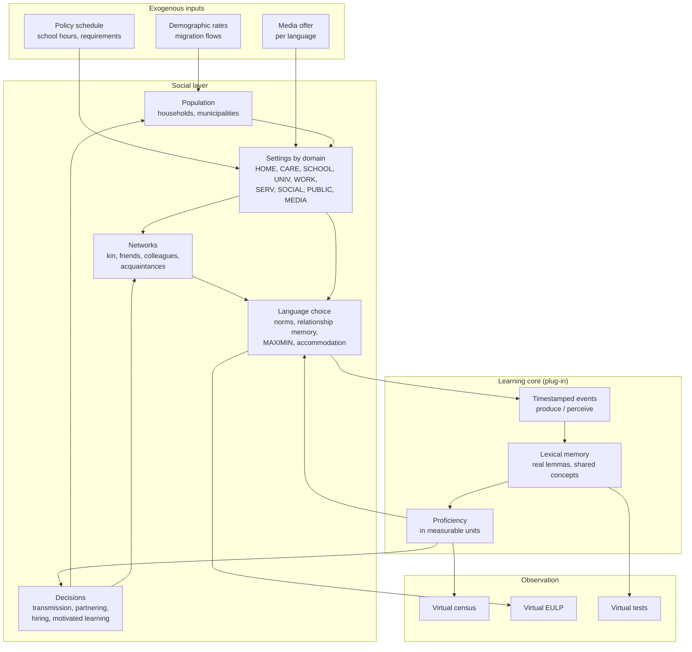

# Conceptual model (ODD overview)

> **Status:** draft v0 (Nov 2026), for discussion. This document describes the
> new model following the ODD protocol for agent-based models (Grimm et al.,
> 2020): Overview, Design concepts, Details. It is at the level of *what* the
> model contains. Each submodel gets its own specification later. It builds on:
> - [`01_vision_and_scope.md`](01_vision_and_scope.md);
> - [`02_society_domains.md`](02_society_domains.md);
> - the learning-core design in
>   [`background/learning_model_new_approaches.md`](background/learning_model_new_approaches.md)
>   (**LMNA**) and
>   [`background/modeling_solutions/essential_language_features.md`](background/modeling_solutions/essential_language_features.md)
>   (features **F1–F5**).

---

## 0. The model in one picture

**The causal loop.** Settings bring people together. Norms and proficiency
decide the language. Events change memory. Memory decides proficiency.
Proficiency changes the next choices of language, transmission, partners and
jobs.

---

## 1. Purpose and patterns

**Purpose.** See [`01_vision_and_scope.md`](01_vision_and_scope.md): explain
and project the survival, shift or erosion of a minority language, and the
effects of policies, with uncertainty.

**Patterns the model must reproduce** (pattern-oriented modelling; Grimm et
al., 2005). The full list is in
[`04_requirements_and_validation.md`](04_requirements_and_validation.md).
- *Individual:* vocabulary growth, spacing and forgetting, attrition by age,
  receptive above productive, cognate effects, domain-specific vocabulary.
- *Interaction:* language choice by interlocutor and domain, accommodation,
  stickiness within relationships.
- *Population, generic world (v1, DEC-08):* generic stylised facts.
  - Parents mostly transmit their strongest language.
  - Immigrants shift over three generations.
  - Domains retreat in order.
  - Accommodation is asymmetric.
  - Shift follows S-shaped curves.
- *Population, specific-society phase (later):* census knowledge by age,
  birthplace and municipality over time; survey use by domain; transmission
  rates by couple type; mixed couples; linguistic homophily.

---

## 2. Entities, state variables and scales

### 2.1 Entities

| Entity | State variables |
|---|---|
| **Person** | id; birth day; sex (for demography); origin (native, or immigrant with arrival day); municipality and household; life stage (derived); memberships in settings; **traits** (rate-of-forgetting offset, encoding efficiency, sociability); **language state** (owned by the learning core); **cached proficiency** per language (comprehension coverage, productive success, census category); **perceptions and attachment** per language (SM-16: perceived status, perceived vitality on fast and slow timescales, attachment); exclusion history per language |
| **Household** | members; home; derived home-language profile |
| **Municipality** | population; location and distances; districts (large cities); settings; derived language composition |
| **Setting** | domain; members; weekly schedule template; register; institutional norm (e.g. hours of instruction per language); capacity. Schools: grade, teachers. Workplaces: sector, size, internal norm, hiring requirement. |
| **Tie** | type (kin with relation, partner, friend, colleague, classmate, neighbour, acquaintance); strength; creation day; meeting count; **language memory**; **perceived profile** of the other person |
| **Exogenous streams** | demographic rates and migration flows (by origin and language profile); **policy schedule over time**; media offer per language and genre |
| **Shared language resources** | for the language pair in use, real or synthetic (§2.3): lexicon (concepts; lemmas per language; frequency and contextual diversity per register); form distances between translation pairs; false friends; domain labels. v3: lexical variants, grammatical variables. |
| **Scenario parameters for each language** | share of speakers and their geography; institutional support (hours of instruction, administration, requirements); media offer. These describe a language's social position as parameters (DEC-07). |

### 2.2 Scales

| Dimension | Choice | Status |
|---|---|---|
| Time of learning events | **days** (each event timestamped) | PROP-04 |
| Social scheduling step | **one week**, with events placed on actual days (weekday or weekend, term or holiday) | PROP-04 |
| Demography | monthly substeps | proposal |
| Institutions | academic year and the annual cycle (simulated years, not calendar dates) | proposal |
| Space | **municipalities as nodes** (districts for large cities); no grid | PROP-05 |
| Population | 10³ agents (development), 10⁴ (v1 target), 10⁵ (later), with a scaling scheme (§9) | Q-12 |
| Simulated span | **generic world:** a burn-in under a baseline scenario, then scenario runs measured in years from their start. No calendar years. | DEC-08 |
| | **specific-society phase:** a historical run from a start year | later |

### 2.3 Language pairs as parameters (DEC-07)

The learning core and the social layer never assume a particular pair.
Everything specific to a pair is input:

| Property of the pair | Real pair (Catalan–Spanish) | Synthetic pair (generator, PROP-11) |
|---|---|---|
| Lexicon size and frequency structure per register | SUBTLEX-CAT/ESP, CHILDES | parameterised frequency distributions (e.g. a three-stage Zipf–Mandelbrot) per register |
| Concepts shared between the languages | the Apertium concept table | generated: share of one-to-one concepts, of concepts specific to one language, of function words |
| Form overlap | spelling and IPA distances | the share of cognates and the distribution of form distances, as parameters |
| False friends | found by comparing forms | a share of false friends, as a parameter |
| Grammatical variables (v3) | measured inventory | number and contact sensitivity, as parameters |

**Checking the generator.** Run the single-agent harness and the generic
world with the **real** pair and with a **synthetic** pair whose parameters are
matched to it. The results must agree within ensemble noise. Then sweeping the
generator's distance parameters answers RQ6. This is the language-similarity
parameter of Mira & Paredes (2005), made concrete in the lexicon.

The **social position** of each language (share of speakers, geography,
institutional support, media offer) is a set of scenario parameters
(§2.1). The same pair can therefore be run as a dominant and a minority
language, or as two balanced languages.

---

## 3. Process overview and scheduling

One **week** is processed in this order:

1. **Calendar.** Day types (weekday, weekend, holiday), school term, the
   days of the virtual surveys.
2. **Demography** (monthly substep):
   - deaths;
   - births, with the **transmission decision**;
   - partnering;
   - arrivals and departures;
   - residential moves;
   - changes of household.
3. **Life-course transitions**, at birthdays and at the start of the academic
   year:
   - entering care, school, the next grade, university, the labour market,
     retirement;
   - hiring and changes of job;
   - teacher staffing.
4. **Generating activities.** Each person's week, from their life stage's
   schedule template, becomes occurrences of settings, each with the people
   present.
5. **Resolving events.** For each occurrence:
   - form groups;
   - **choose the language** (domains document §4.1);
   - the learning core produces the utterances (`produce`);
   - listeners perceive them (`perceive`), giving learning events, exclusion
     records, and updates to ties (meeting counts, language memory, perceived
     profiles).
6. **Learning batch.** The learning core applies the week's events in
   timestamp order.
7. **Refreshing proficiency** (monthly). `assess` updates the cached
   proficiency that social decisions read.
8. **Network maintenance** (periodic): friendships formed and dissolved, ties
   decaying.
9. **Motivation.** Exclusion averages are updated, and reactions are scheduled
   as activities for the next week.
10. **Observation.** A virtual census and a virtual language-use survey at
    regular intervals (e.g. every 5 simulated years); test batteries on
    samples; exposure logs. Perceptions and transmission are recorded as survey
    items (motives spec §8).

**Ordering rule.** Within a week, every social decision reads the proficiency
cached at the last refresh. Every random draw uses a stream keyed to its event.
Together these make the results independent of the order in which agents and
events are processed (principle P4).

---

## 4. Design concepts

| Concept | In this model |
|---|---|
| **Basic principles** | Domains of language use (Fishman, 1972); MAXIMIN (Van Parijs, 2011) and Communication Accommodation Theory (Giles et al., 1991); the status and solidarity dimensions of language attitudes (Ryan et al., 1982); ethnolinguistic vitality (Giles, Bourhis & Taylor, 1977); family language policy (Spolsky, 2004); inertia of language within relationships; declarative memory in the ACT-R family, or an alternative chosen at the first learning-core gate (Q-08); the bilingual lexicon with shared concepts (BIA+, Multilink, RHM); focused tie formation and homophily (Feld, 1981; McPherson et al., 2001); utterance selection for variants (v3; Baxter et al., 2006) |
| **Emergence** | Individual proficiency trajectories; code-switching rates; use profiles by domain; transmission rates; population knowledge and use over time; speed of shift; domain-by-domain retreat |
| **Adaptation** | Language choice in each event; renegotiating a relationship's language; transmission decision; job search; learning effort after exclusion |
| **Objectives** | Three **motives** (DEC-09; motives spec), with separate weights for transmission and for everyday choice: **proficiency** (ease, comfort); **status** (the prestige and usefulness of a language, as perceived); **defence** (attachment × perceived threat). Plus communicative success (MAXIMIN). This is the legacy "pride vs interest" idea, made precise. |
| **Learning** | Lexical learning in the learning core. Social learning: the language memory and perceived profile of each tie. **Perceptions** of each language's status and vitality, learned from experience (SM-16). |
| **Prediction** | Agents do not forecast. Perceived threat compares remembered vitality with current vitality; it is a perception, not a forecast. |
| **Sensing** | Agents know their own proficiency, perhaps with bias for self-reports. They know others' proficiency only as a **noisy perceived profile**, updated by experience (domains document §4.2). They sense each language's status and vitality only through the events they take part in. |
| **Interaction** | Speech in events (directed, group, overheard); one-way input from media |
| **Stochasticity** | Random streams keyed by agent, purpose and event (`numpy.random.SeedSequence`); demography, schedules, group formation, language choice, retrieval |
| **Collectives** | Households, classes, workplaces, friend groups, municipalities |
| **Heterogeneity** | Traits with measured distributions, e.g. the rate of forgetting (Sense et al., 2016); origin; schedules |
| **Observation** | Virtual instruments that match real ones: census, EULP, test battery. Exposure logs. Ensembles with uncertainty bands. |

---

## 5. Initialisation

**Generic world (v1, DEC-08):**

1. **Synthetic population** drawn from parameterised distributions: age
   structure, household types, municipality sizes, and each language's share
   of speakers and geography (scenario parameters).
2. **Founding knowledge.** Founding agents get lexical states by **spin-up**:
   the same learner runs through a personal history sampled from the scenario's
   baseline exposure for their language profile. This avoids a mismatch
   between initial conditions and live dynamics, the legacy flaw M13. States
   can be cached by profile, age and seed.
3. **Perceptions and attachment** start from the founding agents' own
   histories (motives spec §3).
4. **Networks** come from initial memberships in settings. Initial language
   memories come from initial proficiencies via the language-choice rule.
5. **Burn-in.** Run the world under the baseline scenario for one to two
   generations, until the remaining traces of the founding population fade.
   Scenarios then start from that state. Founding conditions thus matter
   little, and every agent alive after the burn-in has a fully endogenous
   history.

**Specific-society phase (later):** a synthetic population from a real
census, with histories specific to each birth cohort (e.g. in Catalonia:
Catalan excluded from school in 1939–75, the 1983 normalisation law, the
immigration waves) and a historical run from a start year.

---

## 6. Input data

See [`05_data_inventory.md`](05_data_inventory.md).

---

## 7. Submodels

Each submodel gets its own specification document before implementation:
mechanism, equations, parameters with priors, data, tests.

| ID | Submodel | First version (v0) | Basis | Main data (mostly for the specific-society phase) | Targets |
|---|---|---|---|---|---|
| SM-01 | Demography | mortality and fertility by age and sex | life tables; fertility rates | plausible ranges now; national statistics later | V29 |
| SM-02 | Partnering | partners from acquaintances, with homophily by language | assortative matching | plausible ranges now; census or surveys later | V26 (later) |
| SM-03 | **Transmission** | each parent chooses A, B or both by a logit over **proficiency, perceived status, defence**, the couple's language and the environment ([`specs/motives_and_transmission.md`](specs/motives_and_transmission.md)) | De Houwer (2007); family language policy (Spolsky, 2004); Fishman (1991) | stylised facts now; transmission surveys later | V31–V33; V25 (later) |
| SM-04 | Migration and mobility | arrivals by origin and language profile; internal moves for job and partner | migration statistics | plausible ranges now; migration statistics later | V33; V17 and V29 (later) |
| SM-05 | Life course and schedules | life stages; weekly templates by stage | time-use surveys | INE time-use survey | V30 |
| SM-06 | Care, school, university | classes by grade; staffing; **hours of instruction per language** | legacy ideas §7 | curriculum regulations; enrolment | V34; V17 and V24 (later) |
| SM-07 | Work | sectors; hiring with requirements; internal norms | legacy ideas §7 | labour-force survey; EULP | V34; V24 (later) |
| SM-08 | Services and public space | encounters; initiator effect and accommodation; perceived profiles | Giles et al. (1991); Woolard (1989) | EULP | V35; V24 and V28 (later) |
| SM-09 | Media | offer × preference | — | audience surveys | V32; V24 (later) |
| SM-10 | Networks | acquaintances from meetings; friendships from shared settings, capacity, homophily, tie strength, decay | Feld (1981); McPherson et al. (2001) | social-network surveys | V27 (later) |
| SM-11 | **Language choice** | the resolution order of domains document §4.1, with a motive-weighted choice (motives spec §6); renegotiation | Van Parijs (2011); Giles et al. (1991); ten Thije & Zeevaert (2007) | EULP | V34, V35; V24 and V28 (later) |
| SM-12 | Exposure generation | word volumes by age and setting; registers; directed vs overheard; topic-first (bursty) sampling | Mehl et al. (2007); LENA; review N18–N19 | recordings; corpora | V11, V30 |
| SM-13 | **Learning core** | **A0**: real lemmas; memory rule from the bake-off; comprehension with coverage and meaning inference; production with competition and control | LMNA §4; features F1–F4 | lexical resources; test norms | V1–V16, V19–V20 |
| SM-14 | Motivation | exclusion memory (moving average in days); reactions | legacy ideas §9; Gardner (1985) | (exposure after exclusion: to collect) | — |
| SM-15 | Measurement | virtual census, language-use survey and test battery; mapping from scores to self-reports; survey items for perceptions | LMNA §3.4; motives spec §8 | census, surveys, test norms | all |
| SM-16 | **Perceptions and motives** | perceived status (status-weighted share of each language in one's experience); perceived vitality (fast and slow) and threat; attachment formed in childhood | status and solidarity (Ryan et al., 1982); ethnolinguistic vitality (Giles et al., 1977; Bourhis et al., 1981) | attitude and vitality surveys (later) | V32, V35; hypothesis H1 |

---

## 8. Interface between the social layer and the learning core

The interface is the one in LMNA §3.1, without the `legacy` plug-in:

| Call | Purpose |
|---|---|
| `add_agent(id, birth_day, traits)`, `remove_agent(id)` | lifecycle |
| `produce(speaker, lang, setting, audience, size, day)` → utterance | what the speaker actually says: (concept, lemma, language, count) |
| `perceive(listeners, utterance, day, directed)` → coverage, understood?, learning events | comprehension and learning |
| `advance(day)` | clock; decay evaluated lazily from timestamps |
| `assess(ids, battery, day)` → scores | virtual tests |
| `proficiency(id)` → per language: understands, speaks, coverage, productive rate | what social decisions read (cached) |
| `snapshot()`, `restore()` | persistence |

**Two learners behind the interface in v1:**

1. **Baseline learner** (review N31). Proficiency in each language as a fitted
   function of cumulative and recent exposure, plus an attrition term (curves
   like Thordardottir's and Unsworth's). It is cheap. It lets the social layer
   be developed and calibrated before A0 is ready, and A0 must beat it on
   held-out targets.
2. **A0**, the grounded lexical learner (LMNA §4.9, revised by the review and
   the features document).

---

## 9. Population scaling: a design problem

Catalonia has about 8 million people. With 10⁴–10⁵ agents, each agent stands
for 80–800 people. Settings must keep realistic sizes (a class of about 25,
workplaces of realistic sizes), so the *number* of settings shrinks, not their
size. Each agent's contacts must keep realistic counts.

| Option | Idea | Pros | Cons |
|---|---|---|---|
| **A. Synthetic region at reduced scale** | Municipalities sampled from the real size distribution and scaled down; per-agent contact patterns kept realistic | the whole range of town types; affordable | cross-municipality ties and mobility need rescaling |
| **B. 1:1 simulation of a real area** | e.g. one county (*comarca*) of 50,000–200,000 people, every person an agent | no scaling artefacts; testable against local data | one area does not represent Catalonia; 10⁵ agents need more memory (lexicon state) |
| **C. Several 1:1 areas** | a few contrasting areas (Barcelona district, industrial town, rural county) | contrasts of language geography; local validation | larger; flows between areas are exogenous |

**Recommendation:** **A**. It is also the natural choice for a generic world
(DEC-08): a synthetic region whose municipality sizes follow a realistic
heavy-tailed distribution. **B** and **C** become options for the
specific-society phase. This is Q-12.

---

## 10. Open questions

The main ones are Q-08 (memory rule), Q-12 (scaling), PROP-04/05 (time step
and space) and PROP-10/11 (the motives model and the language-pair
generator), all in [`06_decisions.md`](06_decisions.md), and the open
questions of the motives spec (§9 there).

## References

- Baxter, G. J., Blythe, R. A., Croft, W., & McKane, A. J. (2006). Utterance selection model of language change. *Physical Review E*, 73, 046118.
- Bourhis, R. Y., Giles, H., & Rosenthal, D. (1981). Notes on the construction of a 'subjective vitality questionnaire' for ethnolinguistic groups. *Journal of Multilingual and Multicultural Development*, 2(2).
- De Houwer, A. (2007). Parental language input patterns and children's bilingual use. *Applied Psycholinguistics*, 28(3).
- Feld, S. L. (1981). The focused organization of social ties. *American Journal of Sociology*, 86(5).
- Giles, H., Bourhis, R. Y., & Taylor, D. M. (1977). Towards a theory of language in ethnic group relations. In H. Giles (ed.), *Language, Ethnicity and Intergroup Relations*. Academic Press.
- Giles, H., Coupland, N., & Coupland, J. (1991). Accommodation theory. In *Contexts of Accommodation*. Cambridge University Press.
- Mira, J., & Paredes, Á. (2005). Interlinguistic similarity and language death dynamics. *Europhysics Letters*, 69(6), 1031–1034.
- Ryan, E. B., Giles, H., & Sebastian, R. J. (1982). An integrative perspective for the study of attitudes toward language variation. In *Attitudes towards Language Variation*. Edward Arnold.
- Spolsky, B. (2004). *Language Policy*. Cambridge University Press.
- Fishman, J. A. (1972, 1991): see [`02_society_domains.md`](02_society_domains.md).
- Gardner, R. C. (1985). *Social Psychology and Second Language Learning*. Edward Arnold.
- Grimm, V., et al. (2005). Pattern-oriented modeling of agent-based complex systems. *Science*, 310(5750).
- Grimm, V., et al. (2020). The ODD protocol for describing agent-based and other simulation models: a second update. *JASSS*, 23(2).
- McPherson, M., Smith-Lovin, L., & Cook, J. M. (2001). Birds of a feather. *Annual Review of Sociology*, 27.
- Sense, F., Behrens, F., Meijer, R. R., & van Rijn, H. (2016). An individual's rate of forgetting is stable over time but differs across materials. *Topics in Cognitive Science*, 8(1).
- ten Thije, J. D., & Zeevaert, L. (eds.) (2007). *Receptive Multilingualism*. John Benjamins.
- Van Parijs, P. (2011). *Linguistic Justice for Europe and for the World*. Oxford University Press.
- Woolard, K. A. (1989). *Double Talk*. Stanford University Press.
